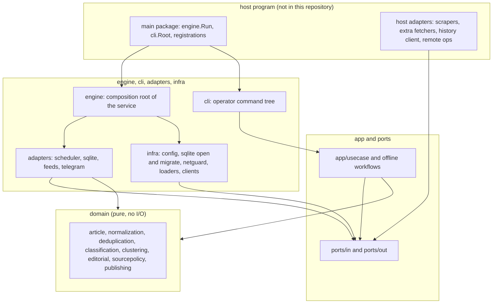

# Architecture

The engine uses ports and adapters (hexagonal architecture). The reasons are
in [ADR 0001](adr/0001-hexagonal-architecture.md); this page describes the
current shape of the code. The online flow is in [PIPELINE.md](PIPELINE.md).

## Layers

| Layer | Owns | May import |
|---|---|---|
| `domain` | Every decision rule: validation, normalization, fingerprints, similarity, relevance, event signals, join decisions, editorial scoring, source policy, freshness and publication policy | the standard library only |
| `ports` | Interfaces between the use cases and the outside: `ports/in` (driving) and `ports/out` (driven) | `domain` |
| `app` | Orchestration of one cycle (`app/usecase`) and offline workflows (training, evaluation, dictionary and entity maintenance, replay) | `domain`, `ports` |
| `adapters` | Implementations of `ports/out` against SQLite, HTTP APIs and Telegram; the scheduler that drives `ports/in` | everything above, plus drivers |
| `infra` | Cross-cutting technical code: configuration, the SQLite connection and migrator, logging, clock, file loaders, HTTP hardening, the LLM, search and Wikidata clients, fetcher wiring | everything above |
| `engine`, `cli` | Composition: build adapters, inject them into use cases, run | everything |

`domain` imports nothing from this module, and the use cases never import an
adapter. A use case recognises adapter outcomes through types declared in
`ports/out` (for example `out.PermanentError`, `out.RateLimitedError` and
`out.AmbiguousError` from a `Publisher`).

## Composition

`engine.Run` is the composition root of the long-running service. In order,
it:

1. loads and validates the configuration (`config.Load`);
2. opens SQLite and applies the embedded migrations;
3. loads the source catalog and builds the fetchers with
   `fetcherwiring.Build`, which evaluates the seven categories (`website`,
   `rss`, `reddit`, `bluesky`, `twitter`, `instagram`, `youtube`, in that
   order) and logs a capability report;
4. builds the Telegram publisher and, when reconciliation is enabled and the
   host supplied one, the channel-history client;
5. loads the relevance dictionary, the editorial model and veto rules, the
   clustering rules and entity catalogs, and the source policies, failing
   fast on any invalid file;
6. wires the use cases and starts `scheduler.Scheduler`, which runs until the
   context is cancelled.

The library implements `rss`, `reddit`, `bluesky` and `youtube`. The other
categories exist in configuration so that a host can supply them through
`fetcherwiring.Extensions`. An enabled category without a builder shows up
in the capability report with an explicit reason; whether that is fatal
depends on `fetch_sources.<category>.on_missing_dependency` and the profile
(see [CONFIG-REFERENCE.md](CONFIG-REFERENCE.md#profiles)). Zero active
sources is always fatal.

`cli.Root()` is the composition root of the operator tools. Commands that
need something only a host can provide (a scraper, remote operations, a
channel-history client) look it up in `cli/cmd/shared` and fail with a
clear error when nothing is registered.

## Packages by concern

| Concern | Packages |
|---|---|
| Intake | `adapters/outbound/rss`, `reddit`, `bluesky`, `youtube`, `compositefetcher`, `sourcefilter`; `infra/rssclient`, `infra/sourcesfile`, `infra/fetcherwiring` |
| Identity and dedup | `domain/ingestidentity`, `domain/normalization`, `domain/deduplication`, `domain/similarity` |
| Relevance | `domain/classification`, `domain/dictionary`, `infra/dictionaryfile` |
| Events | `domain/eventsignals`, `domain/clustering`, `domain/clusterlifecycle`, `domain/clustergate`, `infra/clusteringrules`, `infra/entitycatalog`, `infra/leaguecatalog` |
| Source policy | `domain/sourcepolicy`, `infra/sourcepolicyfile` |
| Editorial | `domain/editorial`, `domain/editorialveto`, `infra/editorialmodel`, `infra/editorialveto`, `app/editorialtrain`, `app/editorialcycle` |
| Publication | `domain/publishing`, `app/usecase` (`PublishOutbox`, `RepairOutbox`, `ExpireOutbox`), `app/outboxreconcile`, `adapters/outbound/telegram` |
| Match state | `domain/matchstate`, `adapters/outbound/espnscoreboard` |
| Storage | `adapters/outbound/sqlite` and the `sqlite*` proposal and cache adapters, `infra/sqlite`, `migrations` |
| Knowledge (tools only) | `infra/wikidata`, `app/knowledgecache`, `domain/entityidentity`, `app/entitydiscovery` |

## Guard rails in tests

- `engine` has a dependency test that fails if the service depends on the
  knowledge-source packages (Wikidata and its cache): an outage of an
  external knowledge service can never affect ingestion.
- `testsupport/repofs` fails any test that reads fixtures outside the
  module root.
- `docscheck` validates this documentation against the command tree.
- CI runs a public boundary check and a consumer smoke test that builds a
  host module against the library.

## Single writer

SQLite allows one writer, and the connection pool has one connection. The
pipeline processes articles one at a time inside a cycle, and the atomic
claim and reservation operations (seen items, outbox leases, cluster
publication slots, cooldowns) rely on that serialisation. See
[DATABASE.md](DATABASE.md) and [ADR 0003](adr/0003-sqlite-primary-storage.md).
