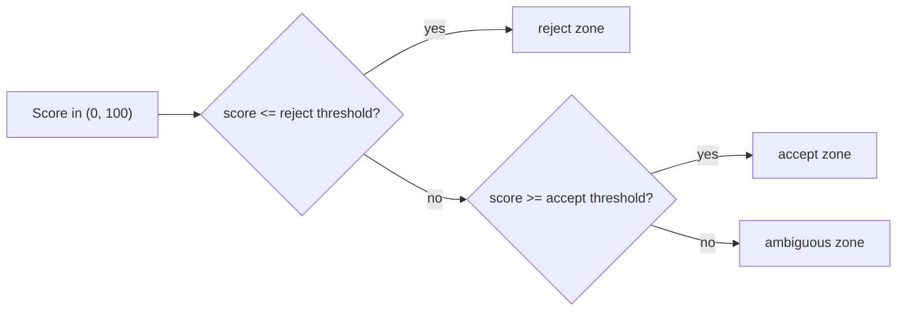

# Relevance and editorial classification

The pipeline has two different gates that are easy to confuse, with a layer
of deterministic vetoes between them:

| Gate | Question | Method | Pipeline step | Result on "no" |
|---|---|---|---|---|
| Relevance (`domain/classification`) | Is this about the covered topic at all? | Weighted dictionary evidence | 3 | `rejected_not_related` |
| Vetoes (`domain/editorialveto`) | Is this gambling, spam, sponsored copy or noise? | Deterministic rules from a YAML file | 3.5 | `rejected_quality` |
| Editorial (`domain/editorial`) | Is this worth publishing? | A linear model over text features | 7 | `rejected_quality`, only in `enforce` or `canary` |

Step numbers refer to [PIPELINE.md](PIPELINE.md).

## Relevance

`classification.Decide` scores an article's title and body against the
dictionary loaded from `dictionary.path` (the example is
`configs/example/example_dictionary.yml`). Every category with a match
contributes its weight times the capped number of occurrences; title hits
count more than body hits. A category can require another category to have
matched too (so an ambiguous nickname alone does not count, but the
nickname next to a roster move does), and a category marked as a strong
override decides "related" on its own. The result carries the evidence it
used, which is written to the rejection reason.

- `classification.trusted_source_ids` skip the gate entirely (audited).
- `classification.context_source_ids` are sources whose scope makes an
  ambiguous mention count, without bypassing scoring.

The dictionary is versioned. `phins-news-engine-tools dictionary validate`,
`phins-news-engine-tools dictionary diff` and
`phins-news-engine-tools dictionary regression-check` check a change before
it ships; the regression dataset is supplied by the host
(`regressiondata.SetCases`).

## Vetoes

`editorial.veto_path` names a rule file (the example is
`configs/example/editorial_vetoes.yml`). Each rule has a `reason_code` and
term lists; a match rejects the article with event `editorial_veto`. Vetoes
apply in every editorial mode and do not need a model. Sources in
`editorial.model_bypass_source_ids` are exempt.
`phins-news-engine-tools editorial veto-report` shows their impact.

## Editorial scoring

- **Features.** A bag of vocabulary terms plus lexicon signals such as
  `lex:clickbait`, `lex:promo`, `lex:rumor`, `lex:contractual` and
  `lex:verifiable_data` (`domain/editorial/lexicon.go`). The feature schema
  is versioned in the model manifest; an unknown feature is ignored.
- **Algorithms.** The offline trainer (`app/editorialtrain`) fits naive
  Bayes, logistic regression, linear SVM and NB-SVM, and reduces the winner
  to one linear model.
- **Score.** `editorial.Predict` computes `bias + sum(weight * feature)` and
  maps it to a ranking score strictly between 0 and 100. It is not a
  calibrated probability.
- **Zones.** The model carries two thresholds:

Because the score is always above 0, a reject threshold of `0` means no
article can land in the reject zone; everything below the accept threshold
is ambiguous and `ambiguous_policy` decides. Inspect a model with
`phins-news-engine-tools validate-model`.

## Modes

`editorial.mode` is required and has no default.

| Mode | Loads the model | Blocks publication | Records |
|---|---|---|---|
| `disabled` | no | never | nothing; a neutral placeholder score |
| `shadow` | yes | never | `editorial_shadow` events with score and zone |
| `canary` | yes | for `editorial_rollout.canary_percent` percent of articles, chosen by hashing the article ID | enforced arm: `editorial` events; other arm: `editorial_canary_shadow` events |
| `enforce` | yes | for every article | `editorial` events with reason codes |

In `enforce` and in the enforced arm of `canary`:

| Zone | `ambiguous_policy: reject` | `ambiguous_policy: accept` |
|---|---|---|
| reject | `rejected_quality` (`editorial:reject_score`) | same |
| ambiguous | `rejected_quality` (`editorial:ambiguous_reject`) | accepted; an `editorial_ambiguous` event flags it |
| accept | continues to freshness and publication | same |

`ambiguous_policy` is required in every mode, so a missing or misspelled
value is a start-up error rather than an implicit choice.

| Setting | Effect |
|---|---|
| `editorial.model_bypass_source_ids` | Never rejected by the model or the vetoes; still scored and audited |
| `editorial.unconditional_publish_source_ids` | Also exempt from freshness rejection; dedup, clustering and the cluster gate still apply |

## Start-up checks

With any mode other than `disabled`, `engine.Run` refuses to start when the
model directory (`model.path`) is missing, its checksum does not match the
manifest, the feature schema is invalid, the thresholds are inconsistent, or
`model.version` is pinned and differs. The model is loaded once at start-up,
so a model swap takes effect after a restart.

## Training and promotion

Models are trained offline from your own labels:
`phins-news-engine-tools train build` assembles the dataset,
`phins-news-engine-tools train evaluate` compares candidates and
`phins-news-engine-tools train run` runs the whole loop. A candidate is
promoted only if it passes `editorial_gates` (precision, recall regression,
PR-AUC, false-positive rate, per-source precision, artifact size and
inference time) and, when configured, `offline_training.promotion`.
`phins-news-engine-tools train rollback` restores the previous model.

The staged rollout thresholds live in `editorial_rollout`.
`phins-news-engine-tools editorial canary status` checks the article count
and elapsed days against them; precision and false-positive rate need
labelled ground truth, so a passing status is necessary but not sufficient.
`canary promote` and `canary abort` print the configuration change to make;
they do not edit files.

## Diagnosis

| Question | Command |
|---|---|
| What did the classifier decide, and what happened? | `phins-news-engine-tools editorial-review` |
| Published articles that scored below their threshold | `phins-news-engine-tools audit quality` |
| Decisions by mode and reason code | `phins-news-engine-tools editorial metrics` |
| Canary progress | `phins-news-engine-tools editorial canary status` |
| Veto impact | `phins-news-engine-tools editorial veto-report` |
