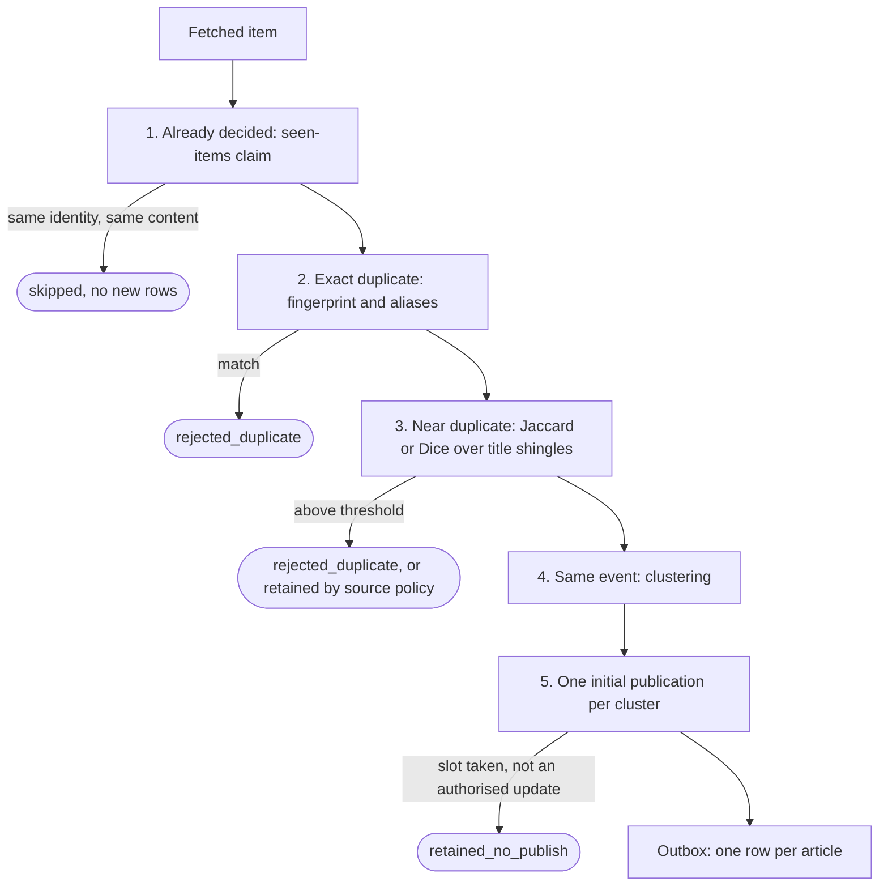

# Deduplication and publication guarantees

The pipeline stops repeats at four layers and enforces one more invariant
when it accepts an article. For each layer this page states what it
guarantees, what it does not, and the residual risks. The reasoning is in
[ADR 0009](adr/0009-cascading-deduplication.md) and
[ADR 0013](adr/0013-incremental-event-clustering.md).

## 1. Already-decided items (stable ingestion identity)

**What.** `domain/ingestidentity` resolves every item to a stable key
derived from the platform, the source, and the source's remote ID when
there is one (the canonical URL otherwise). `seen_items` holds one row per
key. The claim is an atomic insert inside the same transaction that stores
the decision.

**Guarantees.**

- An item whose outcome is recorded and whose content has not changed is
  skipped: no article row, no event row, no classification work. A source
  that keeps serving the same items costs almost nothing per poll.
- If the content changed (`ingestidentity.ContentHash`), the item is
  reprocessed only when its previous status is reprocessable (a `rejected_*`
  status or `discarded`), and it keeps the same article ID. An item that was
  published, is queued, or was deliberately retained is never reprocessed by
  an edit, so it cannot be enqueued twice.
- Keys are namespaced by platform and source, so two sources never collide.

**Not guaranteed.**

- Items without a usable URL fail validation before the claim and are not
  tracked.
- Redirects are not resolved: two URLs that redirect to the same page are two
  identities, unless a known link resolver (`normalization.url.known_link_resolvers`)
  maps them.
- The identity row is deleted with its article. Once retention removes a
  rejected article, an item a source still serves is evaluated again. In
  practice sources expose recent items and freshness rejects old ones, but
  the guarantee is bounded by the retention windows. Published articles are
  never deleted. `phins-news-engine-tools seenitemsbackfill` seeds
  `seen_items` from existing articles.

## 2. Exact duplicates

**What.** `deduplication.Fingerprint` (SHA-256 of the canonical URL) plus
four alias signals in `article_aliases`: external ID, URL alias, content
fingerprint, and an attribute combination (source, normalized title,
`published_at` rounded to `attribute_combo_window_minutes`). The first match
rejects the item and names the signal. Aggregator links are also checked
against their origin URL.

**Guarantees.** The same canonical URL, remote ID or identical content is
never processed twice while the first copy's aliases exist. Matching is
deterministic and uses no threshold.

**Residual risk.** The attribute combination trusts `published_at`; a source
with unreliable timestamps can over- or under-match, which is why it is
checked last.

## 3. Near duplicates

**What.** Candidates come from an inverted term index
(`article_dedup_terms`) limited to `window_hours` and `max_candidates` and
must share `min_shared_terms` terms. Title shingles are then scored with
Jaccard (or Dice). The example configuration uses a default threshold of
0.82, 0.85 for RSS sources (`threshold_by_source_type`) and a stricter
`short_text_threshold` for titles of at most `short_text_max_tokens`
tokens. `content_type_exceptions` (for example `video`) turns a near match
into "same event" instead of "duplicate".

**Guarantees.** A near copy of a recent article is rejected with its scores
recorded, and the lookup never scans the whole articles table.

**Residual risks.** Thresholds must be calibrated on your own data with
`phins-news-engine-tools dedup evaluate`. Title-only comparison misses
paraphrases that share few words; those are the clustering layer's job. A
source policy in `enforce` mode can deliberately retain a near duplicate
(gate A) so that an official confirmation or update may be published later.

## 4. Same event (clustering)

**What.** `eventsignals.Extract` derives action, entity and content signals
from title and summary. Candidates come from an indexed lookup by
approximate event key, and `clustering.DecideJoin` returns join, create or
ambiguous from weighted signals, not text similarity. An ambiguous decision
opens a new cluster, is audited, and the article ends as
`retained_no_publish` (`cluster_ambiguous`). Each member gets a role
(`first_report`, `duplicate`, `confirmation`, `substantial_update`,
`correction`, `analysis`, `reaction`, `primary_source`) and the cluster
keeps an explainable representative. Clusters close after inactivity
(`cluster_lifecycle`) and retention purges them. Rules live in the clustering
rules file (`configs/example/event_clustering_rules.yml` in the example);
measure them with `phins-news-engine-tools clustering evaluate`.

**Residual risks.** Two paraphrases of the same event placed in two clusters
are both published, because the publication gate below is keyed by cluster.
This is the main source of residual duplicates. Over-merging is the
opposite risk. Both are tuned with the offline evaluator.

## 5. One initial publication per cluster

**What.** Before an article is accepted, an atomic compare-and-swap reserves
its cluster's initial-publication slot in `event_cluster_publications`. The
gate is always on and does not depend on the source-policy mode.

**Guarantees.**

- A cluster gets at most one initial publication.
- Roles `first_report`, `analysis`, `reaction` and `primary_source` are
  exempt when the slot is taken. `confirmation`, `substantial_update` and
  `correction` are published only when source policy (in `enforce`)
  authorises them; otherwise the article ends as `retained_no_publish` with
  reason `cluster_gate_denied_duplicate`.
- Source-policy cooldowns are reserved atomically as well.

## 6. Delivery

The decision to publish and its outbox row are written in one transaction,
and `publication_outbox.article_id` is unique, so an article is enqueued at
most once. Duplicate channel posts can then only come from a send whose
outcome is unknown; [ADR 0030](adr/0030-outbox-delivery-guarantee.md)
covers how those are reconciled or quarantined instead of resent.

## Summary of residual risks

| Risk | Layer | Mitigation |
|---|---|---|
| The same event split into two clusters is published twice | 4, 5 | Tune the clustering rules; run `clustering evaluate` |
| A rejected item is evaluated again after retention purged its identity | 1, 2 | Sources expose recent items; freshness rejects old ones |
| Near-duplicate thresholds not calibrated on your data | 3 | `dedup evaluate`; per source-type thresholds |
| A reconciliation false negative resends one message | 6 | Clock-skew floor, quarantine, explicit repair ([ADR 0030](adr/0030-outbox-delivery-guarantee.md)) |
