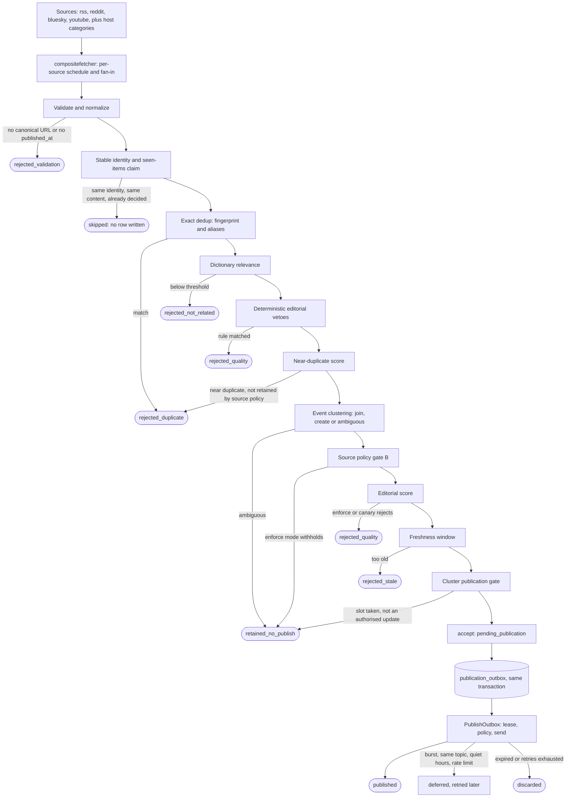

# Online pipeline

How one fetched item travels from a source to a channel message, and what
every terminal state and reason code means. The code is
`app/usecase/process_cycle.go` (`ProcessCycle`) and
`app/usecase/publish_outbox.go` (`PublishOutbox`).

Related: [ARCHITECTURE.md](ARCHITECTURE.md), [DEDUPLICATION.md](DEDUPLICATION.md),
[CLASSIFIER.md](CLASSIFIER.md), [DATABASE.md](DATABASE.md).

## Overview

Two ordering details matter. The deterministic veto runs right after
relevance and before near-duplicate scoring, whatever `editorial.mode` is,
so a vetoed item never consumes clustering, cooldown or outbox capacity. The
editorial score is computed after clustering and source-policy gate B; in
`shadow` mode it never blocks anything.

## Steps

| # | Step | Code | Configuration | Terminal outcome |
|---|---|---|---|---|
| 0 | Fetch | `adapters/outbound/compositefetcher` | `fetch`, `fetch_sources`, the source catalog | none; errors are logged per source and the cycle continues |
| 1 | Validate and normalize | `article.Validate`, `normalization.NormalizeURL` | `normalization` | `rejected_validation` |
| 1.5 | Identity and seen-items claim | `ingestidentity.Resolve`, `SeenItemsRepository.Claim` | `seen_items` | skip (no article row) |
| 2 | Exact dedup | `deduplication.Fingerprint`, alias cascade | `deduplication` | `rejected_duplicate` |
| 3 | Relevance | `classification.Decide`, `dictionary.Matcher` | `classification`, `dictionary` | `rejected_not_related` |
| 3.5 | Editorial vetoes | `editorialveto.Evaluate` | `editorial.veto_path` | `rejected_quality` |
| 4-5 | Near-duplicate decision, source-policy gate A | `similarity`, `deduplication.Decide` | `deduplication.near_duplicate`, `source_policy` | `rejected_duplicate` |
| 6 | Event clustering | `eventsignals.Extract`, `clustering.DecideJoin` | `clustering` | `retained_no_publish` (`cluster_ambiguous`) |
| 6b | Source-policy gate B | `sourcepolicy.Decide` | source policies file | `retained_no_publish` |
| 7 | Editorial classifier | `editorial.Predict` | `editorial`, `model` | `rejected_quality` |
| 8 | Freshness | `publishing.Decide` | `freshness` | `rejected_stale` |
| 8b | Cluster publication gate | `clustergate.Decide`, `ClusterPublicationRepository.Reserve` | none, always on | `retained_no_publish` |
| 9 | Accept and enqueue | `ProcessCycle` | none | `pending_publication` |
| 10 | Publish | `PublishOutbox` | `publication`, `publication_policy`, `telegram` | `published`, `pending_retry`, `discarded` |

Every decision is appended to `article_processing_events` (event type,
`from_status`, `to_status`, `reason_code`, `reason_detail`, `cycle_id`), so
any outcome can be reconstructed with SQL or with
`phins-news-engine-tools audit duplicates` and
`phins-news-engine-tools audit quality`.

## Article states

Defined in `domain/article/article.go`; [ADR 0005](adr/0005-article-lifecycle.md)
explains the model.

| Status | Meaning | Terminal | Reprocessed when the content changes |
|---|---|---|---|
| `fetched` | Just fetched | no | n/a |
| `normalized` | URL and text canonicalised | no | n/a |
| `rejected_validation` | No usable canonical URL or no `published_at` | yes | yes |
| `rejected_duplicate` | Exact or near duplicate | yes | yes |
| `rejected_not_related` | Below the relevance threshold | yes | yes |
| `cluster_candidate` | Being evaluated for clustering | no | n/a |
| `clustered` | Assigned to an event cluster | no | n/a |
| `rejected_quality` | Veto or editorial rejection | yes | yes |
| `rejected_stale` | Outside the freshness window | yes | yes |
| `retained_no_publish` | Valid, clustered, deliberately not published | yes | no |
| `pending_publication` | Accepted; an outbox row exists | no | no |
| `publishing` | Leased by `PublishOutbox` | no | no |
| `published` | Delivered | yes | no |
| `publish_failed` | A send failed (bookkeeping state) | no | no |
| `pending_retry` | Waiting for the next attempt | no | no |
| `discarded` | Expired before sending, or retries exhausted | yes | yes |

"Reprocessed" is `article.IsReprocessable`: only items that never reached,
and were never meant to reach, an outbound effect are evaluated again when
a source edits the title or body. They keep the same article ID.

## Reason codes

`article_processing_events.reason_code` and `articles.status_reason` carry
these. `reason_detail` is free text for humans and may change.

### Intake and deduplication

| Status / event | Reason | Meaning |
|---|---|---|
| `rejected_validation` / `validation` | `article: canonical_url is required` | The item has no usable URL |
| `rejected_validation` / `validation` | `article: published_at is required` | The item has no timestamp |
| `rejected_duplicate` / `dedup` | `exact duplicate: canonical url fingerprint` | Same canonical URL already processed |
| `rejected_duplicate` / `dedup` | alias detail | First matching alias signal (external ID, URL alias, content fingerprint, attribute combination) |
| `rejected_duplicate` / `dedup` | near-duplicate explanation | Similarity above the threshold for its source type |
| `rejected_not_related` / `classification` | `not related: score ...` | Relevance below the threshold, with the evidence used |

### Editorial

| Event | Reason code | Status | Meaning |
|---|---|---|---|
| `editorial_veto` | the rule's `reason_code` (for example `veto_betting`) | `rejected_quality` | A deterministic rule from the veto file matched |
| `editorial` | `editorial:reject_score` | `rejected_quality` | `enforce`: score in the reject zone |
| `editorial` | `editorial:ambiguous_reject` | `rejected_quality` | `enforce`: ambiguous zone with `ambiguous_policy: reject` |
| `editorial` | `editorial:canary_reject`, `editorial:canary_ambiguous_reject` | `rejected_quality` | `canary`, enforced arm |
| `editorial_shadow` | score only | unchanged | `shadow`: recorded, nothing blocked |
| `editorial_ambiguous` | score only | unchanged | `enforce` with `ambiguous_policy: accept`: flagged only |

### Clustering, source policy and the cluster gate

| Event | Reason code | Status | Meaning |
|---|---|---|---|
| `cluster_ambiguous_retain` | `cluster_ambiguous` | `retained_no_publish` | Join or create could not be decided with confidence |
| `source_policy_retain` | `retain_cluster_member`, `official_confirmation_no_publish`, `reject_insufficient_novelty`, `reject_cooldown`, `require_review` | `retained_no_publish` | Gate B withheld publication (only in `enforce`) |
| accepted | `publish_official_confirmation`, `publish_substantial_update`, `standard` | `pending_publication` | Gate B allows publication |
| `cluster_gate_denied_duplicate` | `cluster_gate_denied_duplicate` | `retained_no_publish` | The cluster already has its initial publication and this member is not an authorised update |

Source-policy gates A and B change outcomes only when the policy file's
`mode` is `enforce`; in `shadow` they record what they would have done in
`source_policy_decisions`. The cluster publication gate has no mode.

### Freshness and publication

| Event | Reason code | Status | Meaning |
|---|---|---|---|
| `freshness` | `published_at outside freshness window` | `rejected_stale` | Older than the window for its content type |
| `publish_deferred` | `burst_limit`, `same_topic_limit`, `quiet_hours` | stays `pending_publication` | Deferred by `publication_policy`; never dropped |
| `publish_deferred` | `telegram_rate_limit` | stays `pending_publication` | The destination returned 429; retried after the advertised delay |
| `outbox_expired` | `publish_expired` | `discarded` | The freshness deadline passed before delivery |
| `publish` | | `published` | Delivery confirmed |
| `publish_failed` | error text | `pending_retry` or `discarded` | Confirmed failure; `discarded` once `publication.max_attempts` is reached |
| `reconcile_negative` | reconciliation reason | `pending_retry` | An unknown-outcome send was checked against channel history and not found |

## Publication

`PublishOutbox` leases due outbox rows, applies the publication policy
(burst limit, same-topic limit, quiet hours, a separate live lane for match
milestones when `publication_policy.live` is enabled), sends outside any
database transaction and records the outcome. Delivery guarantees, including
sends whose outcome is unknown, are in
[ADR 0007](adr/0007-transactional-outbox.md) and
[ADR 0030](adr/0030-outbox-delivery-guarantee.md).

## Cadence

`scheduler` drives four loops: `ProcessCycle` every
`check_interval_minutes`, `PublishOutbox` every `outbox_interval_minutes`,
and `CloseInactiveClusters` followed by `RunRetention` every
`cleanup_interval_hours`. Each source also has its own interval in the
source catalog; a cycle fetches only the sources that are due.
